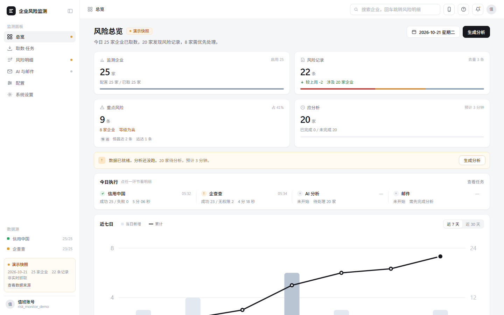
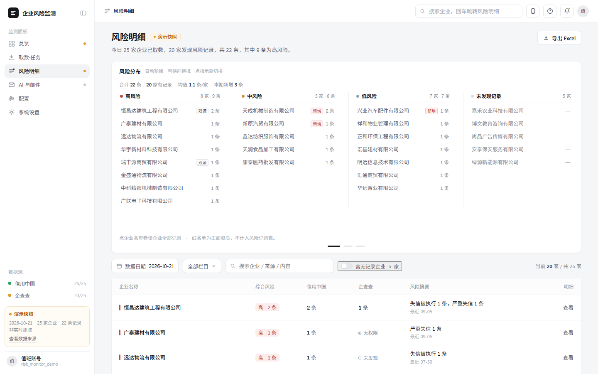
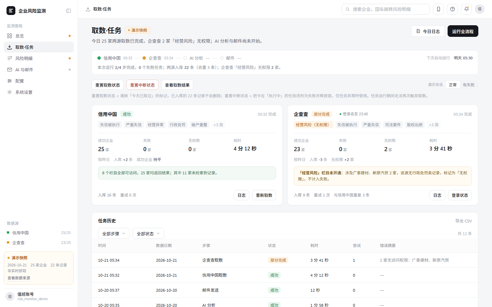
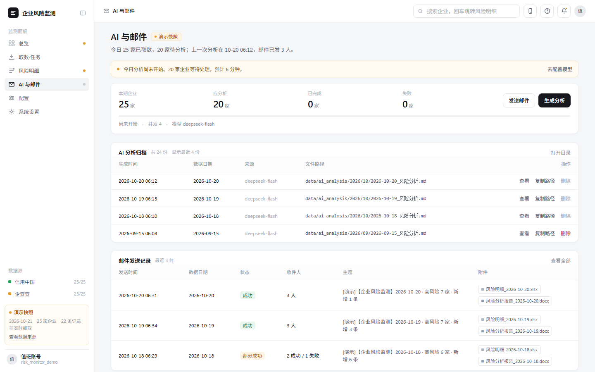
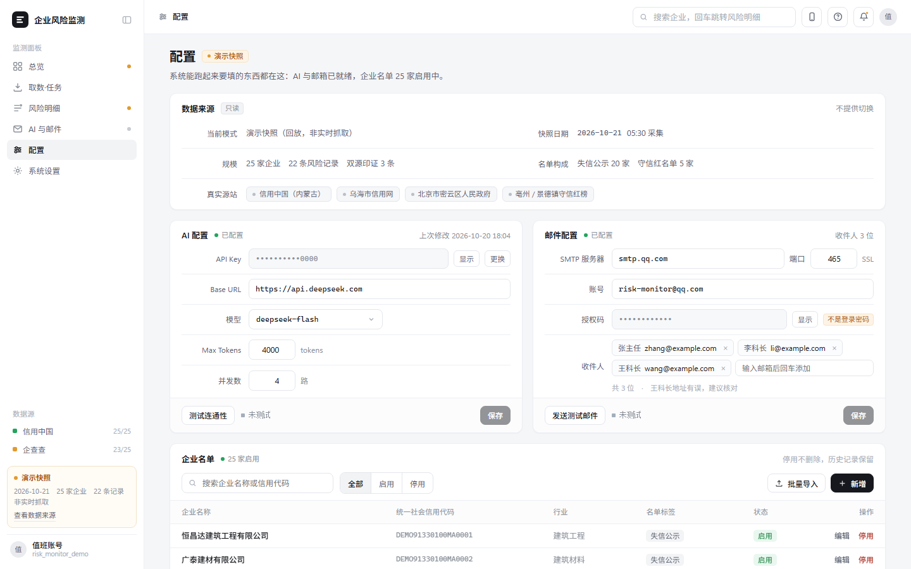
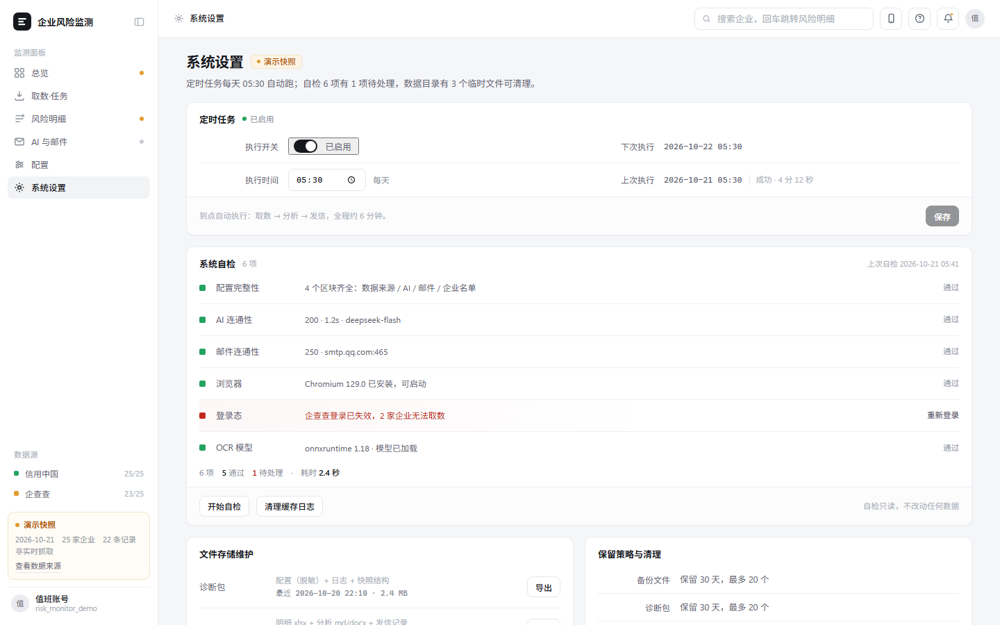
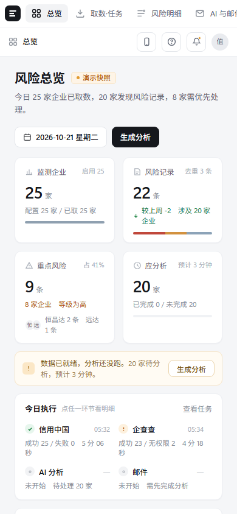
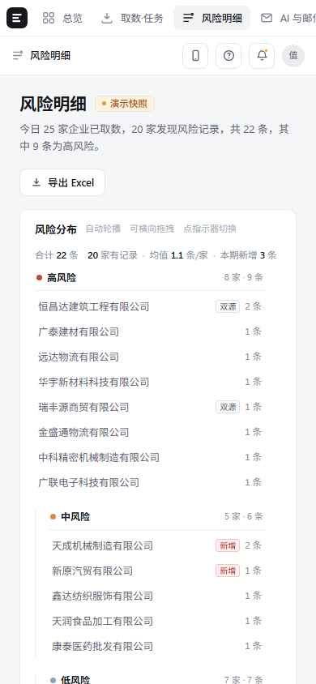

# 企业风险监测系统 · 增强版原型与设计交付

> 面向「领导看结论」的企业风险监测系统，在既有系统（仅存 9 页 PPT 介绍）基础上做**增强重设计**，交付可演示的完整闭环：高保真可交互原型 + 完整文档体系 + 可复现的数据管道。

一句话定位：**把分散的企业风险信息汇总成「一屏能看出问题」的结论，并留痕可追溯。**

---

## 1. 项目背景

原始系统只有一份 9 页 PPT，无代码、无手册。原版存在三类短板：信息平铺导致重点被稀释、文案口径不一致（"条"与"家"混用）、风险明细看不到具体风险内容。

本项目不做 1:1 复刻，而是**信息保留、排版重做**：原有信息项一个不少，交互与信息层级重新设计；工程成本让位于可用性，数据链路、异常提示、状态可见性一律不省。

| 维度 | 结论 |
|---|---|
| 交付形态 | 本地单机、浏览器访问、MySQL 独立实例 |
| 当前阶段 | **不上线**，演示展示为主 |
| 主要受众 | 领导（看结论、看趋势、看邮件） |
| 次要受众 | 操作者（配置、触发、排障） |
| 页面结构 | 6 个一级页签（原 5 个 + 独立「配置」页签） |

---

## 2. 从这里开始看

| 入口 | 文件 | 说明 |
|---|---|---|
| **单文件演示包**（推荐） | `企业风险监测_原型汇总.html` | 6 个页签合并为一个 HTML，零依赖，双击即开 |
| 桌面端全量原型 | `site/pc.html` | 完整交互版本，含风险助手「问小启」 |
| 移动端原型 | `site/m.html` | 独立移动端布局与手势规则 |
| 单页原型（按页签拆分） | `proto/01-总览.html` … `06-系统设置.html` | 便于逐页评审 |
| 交互缺陷体检报告 | `企业风险监测_原型交互体检报告.html` | 原型自检：点击盲区、状态缺失清单 |

### 界面预览

六个一级页签 + 移动端，均为原型实机截图（1440×900 / 390×844）。

**总览** —— 4 张 KPI（监测企业 / 风险记录 / 重点风险 / 应分析）+ 今日取数四段流水线 + 近七日趋势



**风险明细** —— 四态分布看板（高风险 / 中风险 / 低风险 / 未发现记录），未发现记录单独成列，不与"无风险"混同



**取数任务** —— 双源并行取数，每个数据源独立呈现成功 / 部分完成 / 无权限 / 失败，附任务历史与重试次数



**AI 与邮件** —— AI 分析归档（可查看产出文件路径）+ 邮件发送记录，主题统一带 `[演示]` 前缀、正文带快照声明



**配置** —— 数据来源只读展示 + AI / 邮件参数 + 企业名单维护；API Key 与授权码默认掩码，需显式点击才显示



**系统设置** —— 定时任务、6 项系统自检（含"企查查登录态失效"这类真实异常原样暴露）、文件维护与保留策略



**移动端** —— 390px 宽度重排：总览与风险明细保留完整信息层级，演示标识不因窄屏被折叠

| 总览 | 风险明细 |
|---|---|
|  |  |


---

## 3. 文档体系

工程交付不止"画完页面"，四份文档构成一条可追溯的决策链：

| 文档 | 解决的问题 | 规模 |
|---|---|---|
| [需求分析文档](企业风险监测系统_需求分析文档.md) | 做什么、做到什么程度、什么不做 | 14 章 |
| [技术选型说明](企业风险监测系统_技术选型说明.md) | 选什么、为什么选、不选什么 | 8 章（含未选方案汇总） |
| [开发实施说明书](企业风险监测系统_开发实施说明书.md) | 怎么落地：表设计、状态机、API 契约 | 15 章 |
| [UI 设计说明书 v3.0](企业风险监测系统_UI设计说明书_v3.0.md) | 视觉与交互的实测值规范 | 12 章（含 CSS 实测值） |
| [决策台账](企业风险监测系统_决策台账.md) | 每条结论的来源与锁定状态 | 8 节 |
| [PRD v1.0](PRD/企业风险监测系统_PRD_v1.0_20261023.md) | 对外交付版需求说明（含 docx / pdf） | — |
| [功能演示 PPT](企业风险监测系统功能介绍.pptx) | 汇报材料 | 9 页 |

---

## 4. 四条架构原则（决定了很多细节写法）

1. **取数四态，不是布尔**
   无记录必须表达为 `records=[] + collect_state="NO_RECORD"`，**禁止写成"无风险"**——"没查到"和"查过且无风险"是两件事。
2. **AI 只解读、不定级**
   风险等级由规则映射表计算（11 类栏目 → 高/中/低）；AI 入参只给事实（本期/上期/历史/规则等级），**出参禁止 `level` 字段**，校验层直接剔除。
3. **徽章由后端算，前端只渲染**
   `GET /api/overview → tab_badges{key:{state,text,tip}}`，避免前端各自推断导致口径分裂。
4. **状态单一来源**
   任务状态只写 `task_record`，页面读取，不维护第二份状态。

配套的强制约束：数据为快照时，**演示标识不可关闭**——顶栏常驻琥珀色标识条、每页左上角「演示」徽标、导出文件页脚、邮件主题前缀 `[演示]`，避免被误认为实时抓取。

---

## 5. 技术栈（均已实测，非纸面选型）

| 层 | 选型 | 状态 |
|---|---|---|
| 语言 | Python 3.12.7（3.13 不兼容 ddddocr 依赖链） | 已验证 |
| 数据库 | MySQL 8.0.45，独立实例 **3307**（7 表 + 2 新增字段） | 已验证 |
| DB 驱动 | pymysql 1.2.3 | 已验证 |
| AI | `deepseek-flash` @ `https://api.deepseek.com` | 已验证，1.2s |
| 调度 | APScheduler + JobStore 持久化 | 待实现 |
| 浏览器采集 | Playwright | 待实现 |
| 验证码 | ddddocr 1.6.1 | 已验证 |
| 邮件 | smtplib + `smtp.qq.com:465` SSL | 已验证 |

架构分层：

```
前端（浏览器）
  ↓ HTTP
API 层
  ↓
业务层：采集 | 分析 | 邮件 | 调度 | 存储 | 配置
  ↓
适配层：CreditChinaAdapter | QccAdapter(Mock/Real) | ExcelImportAdapter | LlmClient | MailClient
  ↓
存储层：MySQL（结构化） + 文件系统（Excel/MD/DOCX/日志/zip）
```

选型说明中记录了五个实际踩过的坑（模型 ID 不是版本号、推理模型双字段只取 `content`、`max_tokens` 过小返回空内容、清华镜像缺 ddddocr、ddddocr 会把 numpy 拉到 2.x）。

---

## 6. 仓库结构

```
.
├── proto/                      # 6 个单页高保真原型（按页签拆分，评审用）
├── site/                       # 桌面端 / 移动端完整原型（含风险助手）
├── dist/  dist-mobile/         # 打包后的分发版本
├── 企业风险监测_原型汇总.html    # 单文件演示包（6 页签合一，零依赖）
├── PRD/                        # PRD v1.0（md / docx / pdf）
├── docs/screenshots/           # 界面截图（6 页签 + 移动端，README 预览用）
├── data_static/                # 取数快照（credit_china_2026-10-21.json）
├── 企业名单_真实.csv            # 25 家（来源：地方发改委公示）
├── 企业名单_演示.csv            # 20 家（脱敏演示集）
├── config.example.json         # 配置模板（密钥全部为占位符）
│
├── 企业风险监测系统_需求分析文档.md
├── 企业风险监测系统_技术选型说明.md
├── 企业风险监测系统_开发实施说明书.md
├── 企业风险监测系统_UI设计说明书_v3.0.md
├── 企业风险监测系统_决策台账.md
│
├── _build_bundle.py            # 把 proto/ 合成单文件演示包
├── _build_demo.py              # 把 proto/ 打包成 iframe 演示包
├── _batch_query.py             # 信用中国批量查询
├── _fetch_rest.py              # REST 接口补抓
├── _parse_miyun.py             # 密云黑名单解析
├── _make_snapshot.py           # 生成 data_static 快照
├── _make_snapshot2.py          # 快照合并（含黑名单）
└── _load_enterprises.py        # 名单入库（MySQL）
```

> 以 `_` 为前缀的文件是开发期工具脚本，保留是为了让交付物**可复现**；一次性探针脚本与截图审计目录已在 `.gitignore` 中排除。

---

## 7. 快速开始

**只看原型**：双击 `企业风险监测_原型汇总.html`，无需安装任何依赖。

**复现数据管道**（需要本地 MySQL 8 + Python 3.12）：

```bash
pip install pymysql
cp config.example.json config.local.json    # 按注释填写本地口令
export DB_PASSWORD='<你的本地 MySQL 口令>'
python _load_enterprises.py                 # 名单入库
```

`config.local.json` 已被 `.gitignore` 排除，密钥不会入库。

---

## 8. 数据说明

- 快照日期 **2026-10-21**，来源为信用中国公示数据 + 密云区黑名单 + 手工维护名单，经 `_make_snapshot.py` 归一化为 `data_static/credit_china_2026-10-21.json`。
- 企业名单：真实集 25 家（名称与统一社会信用代码来自地方政府公开发布）、演示集 20 家。
- 企查查数据源当前账号无查询权限，取数结果以 `no_permission` 状态显式暴露，不静默降级为"无风险"。

---

## 9. 边界说明

- 本项目**未上线**，为演示与设计交付用途；所有页面携带常驻演示标识，数据为快照而非实时。
- 企查查、信用中国的采集脚本依赖目标站点结构与登录态，站点改版后需同步维护。
- 仓库不含任何生产密钥：`config.example.json` 为占位符模板，真实配置仅存在于本地。
